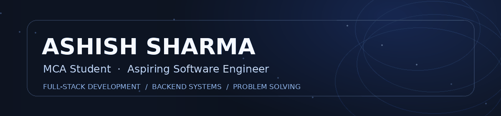

# Ashish Sharma

### MCA Student · Aspiring Software Engineer · Full-Stack Developer

---

## About Me

I'm pursuing a **Master of Computer Applications (MCA) at the University of Hyderabad (2025–2027)**, with a current CGPA of **7.82**. I enjoy building practical software and exploring how applications work across the full stack—from backend APIs and databases to user-facing interfaces.

My interests include **software engineering, full-stack development, backend systems, distributed systems, and applied AI**. I’m continuously improving my problem-solving skills and learning through hands-on projects.

- 🎓 MCA student at the University of Hyderabad
- 💻 Interested in SDE and Full-Stack Development roles
- 🧠 Practising Data Structures and Algorithms on LeetCode
- 🛠️ Enjoy building, testing, debugging, and improving software
- 🤝 Open to software engineering and full-stack internship opportunities

## Technical Skills

**Languages**

**Frontend & Backend**

**Databases, AI & Data**

**Tools, Testing & Cloud**

## Featured Projects

### [ContextIQ — Context-Aware Personal Knowledge Assistant](https://github.com/ashishsharma-13/ContextIQ-RAG)

A Retrieval-Augmented Generation (RAG) application that processes multiple PDF documents and answers questions using retrieved context. It includes semantic retrieval, source and page citations, metadata-based retrieval, comparative multi-document querying, and session-isolated workspaces.

**Technologies:** Python, LangChain, Groq, Hugging Face, ChromaDB, FastAPI, Streamlit, Pytest

### [SCIS Connect — Full-Stack Academic Collaboration Platform](https://github.com/MCA-connect)

An academic collaboration platform project. My work included contributing to application planning and UI workflows, integrating and testing REST APIs, and validating authentication, protected routes, assessments, error handling, and application performance.

**Technologies:** React, Node.js, Express.js, MongoDB, REST APIs, JWT, Docker, Jest, Supertest, JMeter, Postman

### [Distributed Key-Value Storage System](https://github.com/ridzRUSH/Distributed-Key-Value-Storage-System-Using-Consistent-Hashing-and-Replication)

A C-based distributed key-value storage project using consistent hashing for data distribution and replication to simulate distributed storage. It also uses Trie, HashMap, and Linked List components for indexing and lookup.

**Technologies:** C, Data Structures, Consistent Hashing, Trie, HashMap, Linked List

### [AI Resume Screening Platform](https://github.com/ashishsharma-13/AI-Resume-Screening-Platform)

A resume screening application that extracts candidate information, compares resumes with job descriptions, and supports candidate screening through a web interface.

[Live Demo](https://ai-resume-screening-platform1.vercel.app/)

**Technologies:** Python, React

### [School Expertise](https://github.com/ashishsharma-13/School-Expertise)

A Learning Management System built using the MERN stack.

**Technologies:** MongoDB, Express.js, React, Node.js

### [Smart Healthcare Access Platform](https://github.com/ashishsharma-13/Smart-Healthcare-Access-Platform)

A healthcare platform concept focused on improving access to healthcare services and connecting patients with providers.

**Technologies:** MERN Stack

## Experience

**Data Management Intern — Reliance Foundation Youth Sports**  
*Gurugram · September 2023 – October 2023*

- Managed and maintained digital player records across multiple football categories.
- Supported data collection, reporting, and coordination workflows across **50+ school and college teams**.
- Worked with coaches and team captains to validate records and coordinate scheduling updates.

## Education

**Master of Computer Applications (MCA)**  
University of Hyderabad · 2025–2027 · **7.82 CGPA**

**B.Sc. Physical Sciences**  
Zakir Husain Delhi College, University of Delhi · 2021–2024

## Coding Profile

I regularly practise Data Structures and Algorithms, with a focus on writing clear and efficient solutions and improving time and space complexity.

[Visit my LeetCode profile](https://leetcode.com/u/ashishsharma13/)

## Contact

I'm interested in connecting with developers, collaborating on practical projects, and exploring **SDE / Full-Stack internship opportunities**.

- **Email:** [ashishs5137@gmail.com](mailto:ashishs5137@gmail.com)
- **LinkedIn:** [Ashish Sharma](https://www.linkedin.com/in/ashish-sharma-71681b180/)
- **GitHub:** [ashishsharma-13](https://github.com/ashishsharma-13)
- **LeetCode:** [ashishsharma13](https://leetcode.com/u/ashishsharma13/)

---

*Build consistently. Learn deeply. Keep shipping.*

